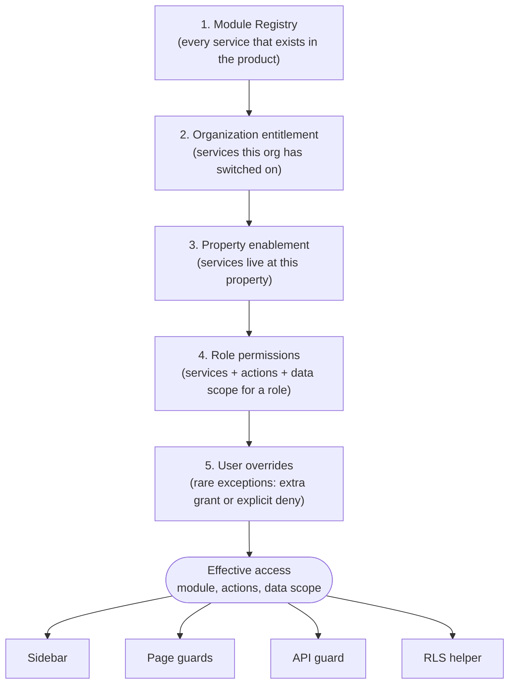
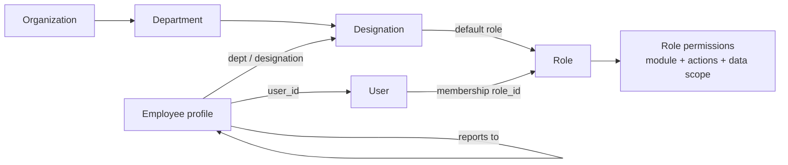
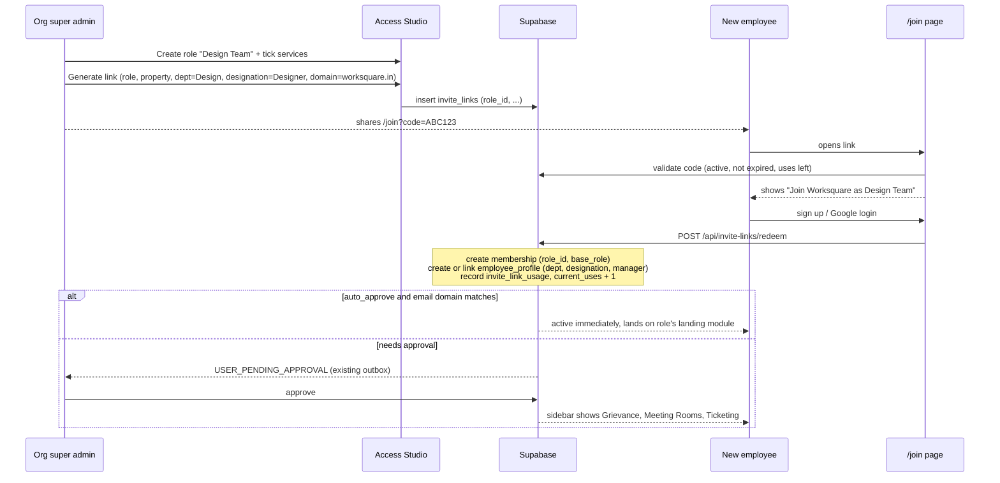

# Role and Service Access Architecture

Status: proposal, nothing built yet
Date: 15 Oct 2026
Scope: roles, module ("service") access, sidebar, onboarding links, employee hierarchy, org and property scoping

---

## 0. The goal in one paragraph

An org super admin should be able to do all of this from the UI, with no code change and no migration:

1. Create a new role, for example **Design Team**.
2. Tick which services that role gets (for example Grievance, Meeting Rooms, Ticketing) and what they can do inside each one (view, create, approve...).
3. See a live preview of the sidebar that role will get.
4. Generate a sign-up link for that role. People who sign up through it land in the right org, property, department and role, and see exactly those services.
5. Say "everyone with designation AI Intern in Tech gets role X, every Manager in Tech gets role Y, and managers can see their reportees' data", and have that keep working when Tech grows from 5 people to 500.
6. Turn services on or off per organization and per property.
7. Later, add HRMS next to FMS, and let a user switch between the two apps if they have access to both.

Today none of this is possible without a developer. Section 1 explains why, section 2 onwards is the design.

---

## 1. What is wrong with the current architecture

Everything below was verified in the code. File references are given so anyone can check.

### F1. Roles are a Postgres enum, so a new role means a migration

- `organization_memberships.role` and `property_memberships.role` are both typed `app_role`, a Postgres enum (`backend/db/schema/evolution.sql:14`).
- Every role ever added came through an `ALTER TYPE app_role ADD VALUE` migration: `super_tenant`, `bd_rep`, `bd_admin`, `org_admin`, `security`, `accounts`, `ops_super_admin`, `hr`, `hr_head`, `procurement`, the soft service roles.
- There is no `roles`, `permissions`, `role_permissions` or `capabilities` table anywhere.

**Effect:** "Design Team" cannot exist as a role unless a developer writes a migration, then edits every place that checks role strings (see F3).

### F2. There are four different role vocabularies and they disagree

| Where | Values |
|---|---|
| DB enum `app_role` | master_admin, org_super_admin, org_admin, ops_super_admin, property_admin, staff, mst, security, tenant, super_tenant, vendor, soft_service_*, bd_rep, bd_admin, accounts, hr, hr_head, procurement |
| TS `RoleKey` (`frontend/types/rbac.ts:3`) | Has super_admin, hk, fe, se, technician, purchase_manager, bd_super_admin, tenant_user... Does **not** have org_super_admin, master_admin, tenant or security |
| `useAppSession.ts:6` | Its own union |
| Code-only strings | owner, admin, member, finance, sales, hr_manager, hr_ops, tenant_admin, food_vendor, uppercase PROPERTY_ADMIN / SUPER_ADMIN... none of these exist in the DB |

Task Manager adds a fifth one (`employee_profiles.task_role`: employee, reporting_manager, superuser).

### F3. Access rules are written by hand in hundreds of places

- About **450 inline role checks** (`role === 'x'`, `[...].includes(role)`) across **119 files** in `app/` and `frontend/`, plus ~136 in `app/api`.
- About **12 separate "access resolver" files** in `backend/lib/*/access.ts` (crm, accounts, aop, assets, electricity, pettyCash, documentBank, procurement, mailbox, commandCenter...). Each has its own hardcoded `*_ROLES` list, and the frontend has duplicate copies of several of them (`frontend/lib/accounts/roles.ts`, `assets/roles.ts`, `pettyCash/roles.ts`, `auth/silos.ts`).
- RLS policies repeat role lists again: 69 inline `role IN (...)` checks in 28 migration files, plus ~20 helper functions (`has_asset_access`, `pc_can_read`, `is_bd_admin`...).
- The one data-like layer, `CAPABILITY_MATRIX` (`frontend/constants/capabilities.ts`), is a TS constant, is used in only 2 components, is used by **zero** API routes, and has no entry for org_super_admin, master_admin, tenant or security.

**Effect:** the rule "who can see Ticketing" lives in the sidebar, in the dashboard component, in the page, in the API route and in RLS, written differently each time. Changing it for one role means touching all of them.

### F4. The sidebar is hand-written, once per role

- `frontend/components/layout/DashboardSidebar.tsx` builds its items inside a `useMemo` with role `if`s (HR list, base list, `isAdmin` extras, `org_super_admin` extras, `ops_super_admin` extras, BD empty list...).
- On top of that, **each role dashboard has its own hand-written `<nav>`**: `OrgAdminDashboard`, `PropertyAdminDashboard`, `MstDashboard`, `StaffDashboard`, `TenantDashboard`, `SecurityDashboard`, `SoftServiceManagerDashboard`, `SuperTenantDashboard`, `ProcurementDashboard`, `MasterAdminDashboard`.
- `UnifiedDashboard.tsx:165-283` picks which dashboard to render with a big `switch` on role. An unknown role (like a new "design_team") falls into **"Access Restricted"**.

**Effect:** a new role gets no sidebar at all, and there is no single list of "all services that exist".

### F5. Per-org and per-property module switches exist but nothing reads them

- `organizations.available_modules text[]` exists and the Master Admin "Module Control" tab writes to it (`MasterAdminDashboard.tsx:406`). **No code reads it to hide or block anything.** `useAppSession.ts:102` even hardcodes its own list instead of reading the column.
- `property_features(property_id, feature_key, is_enabled, settings)` exists with an API and a modal, but the only key in use is `ticket_validation`. It never gates navigation.

**Effect:** the building blocks for "org wise" and "property wise" are there, but they are disconnected.

### F6. Three different answers to "what is this user's role?"

| Consumer | How it decides |
|---|---|
| `DashboardSidebar.tsx:48` | `user_metadata.role` first, then org membership, then first property |
| `UnifiedDashboard` via `useAppSession` | org membership first, then property, then metadata (and a hardcoded email forced to master_admin at line 37) |
| `CapabilityWrapper` via `authService.getMeContext()` | a single `property_memberships` row with `.maybeSingle()`, which returns null for anyone with 2+ properties, then falls back to metadata, then `'staff'` |

**Effect:** the same person can see one thing in the sidebar and another in the dashboard.

### F7. Direct URL access is barely enforced

- `proxy.ts` (middleware) only checks "is logged in". It skips `/api` entirely.
- There is no `app/(dashboard)/[orgId]/layout.tsx`, so `/{orgId}/*` pages never check that the user even belongs to that org.
- Many module pages have no role gate (`procurement-management`, `users`, `rooms`, `settings`, `ai-tickets`, `org-progress`...). Hiding the sidebar link is the only protection.
- 326 of 484 API routes use the service-role client, which bypasses RLS, and there is no shared `requireAccess()` helper. PPM, tickets and task-manager routes check roles in only a minority of routes.

### F8. Onboarding has five paths and the invite link is half built

1. Self sign-up, then `/onboarding` where **the user picks their own role** from a list that includes `property_admin` and `ops_super_admin` (`app/api/onboarding/complete/route.ts:31` only blocks org_super_admin and master_admin). If no property is chosen it takes the first property in the table.
2. Tenant QR at `/onboard?propertyId=...&role=tenant`.
3. **Invite links**: `/api/invite-links/generate` creates rows in `invite_links` and returns `/join?code=...`, but **there is no `app/join/page.tsx` and nothing ever reads `invite_links`**. The link goes nowhere.
4. Email invite (`/api/users/invite`) with roles `member/admin/owner`, which are not in the enum, so the membership write likely fails silently.
5. Admin direct create (`/api/users/create`, `/api/hr/admin/employees`).

`invite_links.role` is typed `app_role`, so even when fixed, it could only point at a hardcoded role.

### F9. Employee data and hierarchy are hand-seeded and do not scale

- The "Excel import" for Grievance is a **migration with 117 literal rows** (`supabase/migrations/20260910000002_seed_employee_master.sql`), using `SELECT id FROM organizations LIMIT 1` as the org.
- `reporting_manager_code` actually stores the manager's **name**, and managers are linked by fuzzy name prefix matching. A later migration hardcodes ~11 name fixes (`20260919000007_normalize_employee_reporting_managers.sql`).
- There is no runtime Excel/CSV importer for employees.
- Department and designation are free text on `employee_profiles`. `departments` exists (from Task Manager) but has **no `organization_id`** and `name` is globally unique, so two orgs cannot both have a "Tech" department. There is no `designations` table.
- "Is a manager" is a manually set `task_role` flag, not derived from the reporting tree.
- `TaskAccessService.ts:17` hardcodes `TECH_DEPARTMENT_ID`. The org UUID `211e1330-...` is hardcoded ~42 times as a fallback.
- `employee_profiles` is completely separate from role and membership. A person's department or designation has **no effect** on what they can access.

**Effect:** it works for ~100 people because someone fixed names by hand. At 1,000 people across several orgs it breaks.

### F10. Security gaps found during this review (separate from the redesign)

These are real holes today and should be fixed before or alongside Phase 1. They are listed here, not fixed, because CLAUDE.md requires explicit approval before touching auth code.

| # | Issue | Where |
|---|---|---|
| S1 | Any logged-in user can change any user's role. The route authenticates the caller but never checks the caller's role before rewriting memberships with the service-role client. | `app/api/users/update-role/route.ts:34-408` |
| S2 | HR employee directory and reconciliation APIs use the service-role key with **no caller authentication at all**, and `/api` is excluded from middleware. Anyone with the URL can read and edit employee records. | `app/api/hr/admin/employees/route.ts`, `app/api/hr/admin/reconcile/route.ts` |
| S3 | RLS on `employee_profiles` and all `hr_*` tables is `USING (true)` for every authenticated user, so a tenant can read every grievance. | `20260910000001_hr_ticketing_module.sql:183-196` |
| S4 | Users can request admin roles for themselves during onboarding (only approval stands in the way). | `app/api/onboarding/complete/route.ts:31` |
| S5 | Master admin identity is a hardcoded email in SQL (`public.is_master_admin()`) and in two frontend files. | `fix_master_admin_organizations_rls.sql:15`, `useAppSession.ts:37`, `CrmOnboardingGate.tsx:44` |
| S6 | `/{orgId}/*` routes never verify org membership. | missing `app/(dashboard)/[orgId]/layout.tsx` |

### Root cause, summarised

> **Roles, services and people are three separate worlds, and the links between them are written in code instead of stored as data.**

- "What services exist" is not stored anywhere (it is scattered across sidebars).
- "Which role gets which service" is stored in ~600 places in code.
- "Which person gets which role" is stored in membership tables, but "who is this person in the company" (department, designation, manager) is stored in a different table that access control ignores.

---

## 2. Target architecture

### 2.1 The five layers

Access for any user is computed from five layers. Each layer can only **narrow** what the layer above allows, except explicit user grants (layer 5), which still can never go beyond layer 2.



**One computation, four consumers.** The sidebar, the page guard, the API check and RLS all ask the same question ("can user U do action A on module M at property P?") and get the same answer.

### 2.2 People layer, linked to access



- An employee's **designation decides their default role**. AI Intern in Tech gets "Tech Member". Manager in Tech gets "Tech Manager".
- **"Manager" is derived from the reporting tree**, not a flag. If anyone reports to you, you are a manager. A role permission with data scope `team` then automatically shows you your direct and indirect reportees' data.
- When Tech grows, HR adds people (or imports a sheet) with a department, a designation and a manager code. Access follows automatically. Nobody touches roles.

### 2.3 Apps (FMS, HRMS, and later more)

Every module belongs to one **app**: `fms`, `hrms`, `crm`, `finance`, `platform`. The top bar gets an **app switcher** that shows only the apps where the user has at least one module. Same login, same employee profile, same roles. HRMS modules (Grievance, Leave, Attendance, Payroll later) are just more rows in the registry.

---

## 3. Data model

All DDL below is a **sketch for review**, not a migration. Names follow existing conventions (`organization_id`, `property_id`, `is_active`, `created_at`, `updated_by`). The existing tables are **reused and extended** wherever possible.

### 3.1 Module registry (new, small, seeded from code)

```sql
CREATE TABLE app_modules (
  key            text PRIMARY KEY,            -- 'ticketing', 'ppm', 'electricity', 'grievance', 'meeting_rooms'...
  app_key        text NOT NULL,               -- 'fms' | 'hrms' | 'crm' | 'finance' | 'platform'
  label          text NOT NULL,
  icon           text,                        -- lucide icon name, matches what sidebars use today
  route          text NOT NULL,               -- '/{orgId}/dashboard?tab=requests' style template
  scope_level    text NOT NULL CHECK (scope_level IN ('org','property')),
  actions        text[] NOT NULL DEFAULT '{view}',  -- actions this module supports
  parent_key     text REFERENCES app_modules(key),  -- for sub-modules (e.g. electricity.validation)
  sort_order     int  NOT NULL DEFAULT 100,
  is_active      boolean NOT NULL DEFAULT true
);
```

- This is the **single list of all services**. It replaces the hardcoded arrays in every sidebar and the tab list in `frontend/lib/dashboard/orgTabs.ts`.
- The same list also lives in TS as `frontend/lib/modules/registry.ts` (route, icon component, lazy component import). A tiny check (unit test or startup assert) makes sure the TS registry and the DB rows have the same keys.
- Standard actions (a superset of today's `CapabilityAction`): `view, create, update, delete, approve, assign, export, configure`. Each module declares which ones it supports, so the UI only shows meaningful checkboxes.

Initial seed, taken from what exists today:

| app | modules |
|---|---|
| fms | overview, ticketing (requests), flow_map, ppm, checklist, electricity, electricity_validation, diesel, water, assets, stock, inventory, procurement, monthly_requisitions, vendors, visitors, meeting_rooms, roster, escalation, cafeteria, guest_experience, client_support, document_bank, super_tenants, reports |
| hrms | grievance, my_grievances, employee_directory, org_tree, identity_reconciliation, notes_tracker, task_manager (later: leave, attendance, payroll) |
| crm | crm_pipeline, crm_settings |
| finance | petty_cash, accounts, aop, payment_tracker |
| platform | users, access_studio, ai_automation, org_progress, org_efficiency, agent_console, settings, profile |

### 3.2 Organization entitlement (reuse and fix `available_modules`)

Two options:

- **Option A (smallest change):** keep `organizations.available_modules text[]`, finally **read it**, and validate values against `app_modules.key`.
- **Option B (recommended):** a proper table, so we can store per-org settings and audit changes:

```sql
CREATE TABLE organization_modules (
  organization_id uuid REFERENCES organizations(id) ON DELETE CASCADE,
  module_key      text REFERENCES app_modules(key),
  is_enabled      boolean NOT NULL DEFAULT true,
  settings        jsonb   NOT NULL DEFAULT '{}',
  updated_by      uuid REFERENCES users(id),
  updated_at      timestamptz NOT NULL DEFAULT now(),
  PRIMARY KEY (organization_id, module_key)
);
```

Backfill: every existing org gets **every module enabled**, so nothing changes on day one. `available_modules` stays readable during the transition and is dropped later.

Who edits it: master admin (what the org bought) and org super admin (can switch off, cannot switch on what master admin has not enabled, if we want plan-based billing later).

### 3.3 Property enablement (reuse `property_features`)

`property_features(property_id, feature_key, is_enabled, settings)` already has the right shape, an API and a modal. Reuse it with a key convention:

- `feature_key = 'module:ticketing'` means "Ticketing is live at this property".
- **No row means inherit from the org.** Only rows with `is_enabled = false` need to exist, so the table stays small.
- Existing feature keys like `ticket_validation` keep working untouched.

### 3.4 Roles as data (new)

```sql
CREATE TABLE roles (
  id              uuid PRIMARY KEY DEFAULT gen_random_uuid(),
  organization_id uuid REFERENCES organizations(id) ON DELETE CASCADE,  -- NULL = system role
  key             text NOT NULL,             -- 'design_team', 'tech_manager'
  name            text NOT NULL,             -- 'Design Team'
  description     text,
  scope_level     text NOT NULL CHECK (scope_level IN ('org','property')),
  base_role       app_role NOT NULL,         -- legacy role this maps to (see 3.6)
  landing_module  text REFERENCES app_modules(key),  -- where the user lands after login
  is_system       boolean NOT NULL DEFAULT false,    -- system roles cannot be deleted
  is_active       boolean NOT NULL DEFAULT true,
  created_by      uuid REFERENCES users(id),
  created_at      timestamptz NOT NULL DEFAULT now(),
  updated_by      uuid REFERENCES users(id),
  updated_at      timestamptz NOT NULL DEFAULT now(),
  UNIQUE (organization_id, key)
);

CREATE TABLE role_permissions (
  role_id     uuid REFERENCES roles(id) ON DELETE CASCADE,
  module_key  text REFERENCES app_modules(key),
  actions     text[] NOT NULL DEFAULT '{view}',
  data_scope  text NOT NULL DEFAULT 'property'
              CHECK (data_scope IN ('self','team','department','property','org')),
  sort_order  int,                               -- optional per-role sidebar order
  PRIMARY KEY (role_id, module_key)
);
```

- Every current `app_role` value is seeded as a **system role** (`organization_id NULL`, `is_system true`), with `role_permissions` that reproduce **exactly what that role sees today**. This seed is the contract that Phase 1 must not change behaviour.
- **Custom roles** are org-owned rows. "Design Team" is just an insert.
- **`data_scope`** answers "whose records can they see inside the module":
  - `self`: only records they raised or are assigned to
  - `team`: self plus all direct and indirect reportees (from the reporting tree)
  - `department`: everyone in their department
  - `property`: everything at the properties they belong to
  - `org`: everything in the org

### 3.5 Assigning roles to users (extend the existing membership tables)

```sql
ALTER TABLE organization_memberships ADD COLUMN role_id uuid REFERENCES roles(id);
ALTER TABLE property_memberships     ADD COLUMN role_id uuid REFERENCES roles(id);
```

- Backfill `role_id` from the existing `role` value (system role with the same key).
- **Keep the `role app_role` column.** It becomes the **base role**, always equal to `roles.base_role` (kept in sync by a trigger). This is what lets all ~450 existing inline checks keep working while we migrate (see 3.6).
- Primary keys stay `(user_id, organization_id)` and `(user_id, property_id)`, so a user keeps **one role per org and one per property**, the same rule as today. Exceptions go into overrides (3.7), not into multiple roles. This keeps the mental model simple for admins.

### 3.6 Why `base_role` matters (the safe migration trick)

If a custom role had no link to the old world, every one of the ~600 existing role checks would treat "design_team" as unknown and block it (exactly what `UnifiedDashboard` does today). So each custom role picks a **base role** from the existing list:

| Custom role | base_role | Why |
|---|---|---|
| Design Team | `staff` | Internal employee, property-level, no admin powers |
| Tech Manager | `staff` | Same, gets extra modules and `team` scope through `role_permissions` |
| Regional Ops Head | `ops_super_admin` | Org-level operations view |

Old code keeps asking `role === 'staff'` and gets a sensible answer. New code asks `can('meeting_rooms','view')` and gets the precise answer. As modules move to the new check, `base_role` matters less, until it only drives the legacy screens that have not been migrated.

### 3.7 User overrides (new, for exceptions only)

```sql
CREATE TABLE user_module_overrides (
  id              uuid PRIMARY KEY DEFAULT gen_random_uuid(),
  user_id         uuid REFERENCES users(id) ON DELETE CASCADE,
  organization_id uuid REFERENCES organizations(id) ON DELETE CASCADE,
  property_id     uuid REFERENCES properties(id) ON DELETE CASCADE,  -- NULL = all properties in org
  module_key      text REFERENCES app_modules(key),
  effect          text NOT NULL CHECK (effect IN ('grant','deny')),
  actions         text[] NOT NULL DEFAULT '{view}',
  data_scope      text,
  reason          text NOT NULL,
  expires_at      timestamptz,
  created_by      uuid REFERENCES users(id),
  created_at      timestamptz NOT NULL DEFAULT now()
);
```

Use case: "Riya in Design also needs Procurement view for 2 weeks". Mandatory `reason`, optional expiry, fully audited. If many people need the same override, that is a signal to create a role instead, and the Access Studio should say so.

### 3.8 Organization structure (fix `departments`, add `designations`)

```sql
-- departments exists, but has no organization_id and a globally unique name
ALTER TABLE departments ADD COLUMN organization_id uuid REFERENCES organizations(id);
ALTER TABLE departments ADD COLUMN default_role_id uuid REFERENCES roles(id);
-- replace UNIQUE(name) with UNIQUE(organization_id, name) after backfill

CREATE TABLE designations (
  id              uuid PRIMARY KEY DEFAULT gen_random_uuid(),
  organization_id uuid NOT NULL REFERENCES organizations(id) ON DELETE CASCADE,
  department_id   uuid REFERENCES departments(id),   -- NULL = usable in any department
  name            text NOT NULL,                     -- 'AI Intern', 'FDE', 'Manager'
  level           int,                               -- optional grade, higher = more senior
  default_role_id uuid REFERENCES roles(id),
  is_active       boolean NOT NULL DEFAULT true,
  UNIQUE (organization_id, department_id, name)
);

ALTER TABLE employee_profiles ADD COLUMN designation_id uuid REFERENCES designations(id);
ALTER TABLE employee_profiles ADD COLUMN reporting_manager_employee_code text;  -- real code, not a name
ALTER TABLE employee_profiles ADD COLUMN work_property_id uuid REFERENCES properties(id);
```

**Role resolution order for an employee** (first match wins):

1. Role explicitly set on their membership by an admin (`role_id`, flagged as manual)
2. `designations.default_role_id` for their designation
3. `departments.default_role_id` for their department
4. Org default role (for example "Employee")

When HR changes someone's designation or department, a trigger (or the save API) recomputes their role **unless** an admin set it manually. That is how "department grows" stays zero-touch.

### 3.9 Reporting tree (reuse `reporting_manager_id`, add a SQL helper)

`employee_profiles.reporting_manager_id` stays the single source of truth. Add one function so RLS and APIs can use it, instead of only the TS `OrgHierarchy.ts`:

```sql
CREATE FUNCTION get_reportee_user_ids(p_manager uuid)
RETURNS SETOF uuid LANGUAGE sql STABLE SECURITY DEFINER AS $$
  WITH RECURSIVE tree AS (
    SELECT user_id FROM employee_profiles
     WHERE reporting_manager_id = p_manager AND is_active IS NOT FALSE
    UNION
    SELECT e.user_id FROM employee_profiles e
      JOIN tree t ON e.reporting_manager_id = t.user_id
     WHERE e.is_active IS NOT FALSE
  )
  SELECT user_id FROM tree WHERE user_id IS NOT NULL;
$$;
```

(`UNION`, not `UNION ALL`, so a cycle in bad data cannot loop forever.)

`task_role = 'reporting_manager'` stops being a hand-set flag and becomes derived: "has at least one reportee". `superuser` becomes a role permission (`task_manager` with `data_scope = 'org'`).

### 3.10 Invite links (finish the existing table)

```sql
ALTER TABLE invite_links ADD COLUMN role_id            uuid REFERENCES roles(id);
ALTER TABLE invite_links ADD COLUMN department_id      uuid REFERENCES departments(id);
ALTER TABLE invite_links ADD COLUMN designation_id     uuid REFERENCES designations(id);
ALTER TABLE invite_links ADD COLUMN default_manager_id uuid REFERENCES users(id);
ALTER TABLE invite_links ADD COLUMN allowed_email_domains text[];   -- e.g. {worksquare.in}
ALTER TABLE invite_links ADD COLUMN auto_approve       boolean NOT NULL DEFAULT false;
ALTER TABLE invite_links ALTER COLUMN property_id DROP NOT NULL;     -- org-level roles have no property
```

The existing `role app_role` column is kept and filled with the role's `base_role`.

---

## 4. How effective access is computed

One SQL function is the source of truth. Everything else calls it.

```sql
-- Returns one row per module the user can use in this org (and property, if given)
CREATE FUNCTION get_effective_access(p_user uuid, p_org uuid, p_property uuid DEFAULT NULL)
RETURNS TABLE (module_key text, actions text[], data_scope text)
LANGUAGE sql STABLE SECURITY DEFINER AS $$
  -- 1. role of this user here (property membership wins over org membership for property modules)
  -- 2. role_permissions of that role
  -- 3. AND module enabled for org        (organization_modules)
  -- 4. AND module not disabled at property (property_features 'module:<key>')
  -- 5. UNION user_module_overrides 'grant' (still filtered by step 3)
  -- 6. MINUS user_module_overrides 'deny'
  -- master admin: every active module, all actions, scope 'org'
  ...
$$;
```

Rules in plain words:

1. Start from the role's permissions.
2. Remove anything the org has not switched on.
3. For property-level modules, remove anything switched off at that property.
4. Add user grants, but never anything the org has not switched on.
5. Remove user denies. **Deny always wins.**
6. Master admin bypass stays, but is read from `users.is_master_admin`, never from an email.

And a thin helper for RLS and APIs:

```sql
CREATE FUNCTION has_module_access(p_module text, p_action text, p_property uuid DEFAULT NULL)
RETURNS boolean ...  -- uses auth.uid() and the property's org
```

### 4.1 Server side (Next.js)

New `backend/lib/access/` (same shape as the existing per-module resolvers, so it feels familiar):

```ts
// backend/lib/access/requireAccess.ts
export async function requireAccess(
  req: Request,
  moduleKey: ModuleKey,
  action: ModuleAction = 'view',
  opts?: { propertyId?: string; orgId?: string }
): Promise<AccessContext | NextResponse>  // 401/403 NextResponse on failure

// AccessContext = { userId, orgId, propertyIds, roleId, baseRole, actions, dataScope, reporteeIds? }
```

- Existing resolvers (`resolveElectricityAccess`, `resolvePettyCashAccess`...) keep their signatures but internally call `requireAccess`. This means the 118 routes that already use a resolver switch over without being edited.
- `dataScope` is returned so the route can filter its query (`self`, `team` → `user_id IN reporteeIds`, etc.).

### 4.2 Client side

- `GET /api/me/access?orgId=&propertyId=` returns `{ apps, modules: [{key, actions, dataScope}], role, landingModule }`.
- One `AccessProvider` (React context) loads it once per org/property switch and exposes `useAccess()` with `can(module, action)`.
- This **replaces** the three disagreeing role sources (F6): `DashboardSidebar` metadata, `useAppSession`, and `authService.getMeContext()`. `AuthContext` keeps doing identity and memberships, as it does today.
- `CapabilityWrapper` is kept as a component but re-pointed to `useAccess().can()`, so existing usages keep working.

### 4.3 Sidebar

```ts
// one sidebar for everyone
const items = MODULE_REGISTRY
  .filter(m => m.app === currentApp)
  .filter(m => access.can(m.key, 'view'))
  .sort(byRoleOrderThenRegistryOrder);
```

- `DashboardSidebar` becomes registry-driven. The per-dashboard hand-written `<nav>` blocks are replaced one dashboard at a time.
- `UnifiedDashboard`'s role `switch` changes from "unknown role = Access Restricted" to "render the role's `landing_module`", with `base_role` used to pick the legacy dashboard while it still exists.

### 4.4 Page guards

- Add `app/(dashboard)/[orgId]/layout.tsx` that verifies org membership (fixes S6).
- A `<ModuleGuard module="ppm">` wrapper (client) plus the API check (server) on every module page. The API check is the real wall; the page guard is for a clean "no access" screen instead of a broken page.

---

## 5. The UI: "Access Studio" (the playground)

A new admin area under Org Admin, module key `access_studio` (itself permission-controlled, default only org_super_admin).

### 5.1 Screens

**A. Roles**
- List of system roles (read-only, can be cloned) and custom roles.
- "Create role": name, description, org-level or property-level, base role (dropdown with plain-English help: "Internal staff", "Property admin", "Tenant"...), landing page.
- Clone role: copy an existing role's permissions as a starting point.

**B. Role editor (the playground)**

```
+---------------------------------------------------------------------+
| Role: Design Team        Base: Staff        Scope: Property         |
+----------------------------------+----------------------------------+
| Services                         |  Live sidebar preview            |
|                                  |                                  |
| FMS                              |  [FMS v]                         |
|  [x] Ticketing   view create     |   - Ticketing                    |
|                  scope: self     |   - Meeting Rooms                |
|  [x] Meeting Rooms view create   |                                  |
|  [ ] PPM                         |  [HRMS]                          |
|  [ ] Electricity                 |   - Grievance                    |
|  ...                             |                                  |
| HRMS                             |  Users with this role: 0         |
|  [x] Grievance   view create     |  [Preview as a user...]          |
|                  scope: self     |                                  |
+----------------------------------+----------------------------------+
|  Drag to reorder sidebar.   [Save]   [Generate sign-up link]        |
+---------------------------------------------------------------------+
```

- Modules the org has not enabled are shown greyed out with "Not enabled for this org".
- Only actions the module supports are shown as checkboxes.
- Data scope dropdown per module (self, team, department, property, org).
- **Preview as user**: pick a real user, see their exact effective sidebar (calls `get_effective_access` for them). This is the fastest way to debug "why can't X see Y".
- Save writes `role_permissions` and an audit row.

**C. Org modules**
- Toggle per module for the org (writes `organization_modules`).
- Per property, override (writes `property_features` with `module:` keys).
- Matrix view: properties as columns, modules as rows.

**D. Org structure**
- Departments (per org) with default role.
- Designations per department with default role and level.
- Org tree view (reuse the existing "Org Reporting Tree" HR screen).

**E. People**
- Employee directory (reuse the HR one), with department, designation, manager, role, and an "access" column showing effective modules.
- **Bulk import** (section 7).
- Per-user overrides with reason and expiry.

**F. Invite links**
- Create link: role, property (if property-level), department, designation, default manager, email domain restriction, auto-approve, expiry, max uses.
- List with usage counts, deactivate.

**G. Audit log**
- Every change to roles, permissions, org modules, property modules, overrides and invite links, with who and when. Reuse `user_management_audit_logs` if its shape fits, otherwise a sibling `access_audit_logs` table.

---

## 6. Sign-up through a role link (end to end)



Changes to existing flows:

- **Build** `app/join/page.tsx` and `app/api/invite-links/redeem/route.ts` (the generator exists, the redeemer does not).
- Let org super admins (not only master admin) generate links for their own org. Update the `invite_links` RLS accordingly.
- **`/onboarding` stops letting users pick admin roles.** Without a link, a self sign-up gets the org's default "Employee" role in pending state, and an admin picks the real role at approval time. With a link, the role comes from the link.
- Approval (`/api/users/approve`) keeps working as today. At approval the admin can change the role (dropdown of `roles`, not of the enum).
- Existing tenant QR flow becomes just another invite link with role Tenant. It keeps its current URL as an alias.

---

## 7. Employees at scale: import and sync

Replace "migration with 117 literal rows plus fuzzy name matching" with a runtime importer.

### 7.1 Import template (one sheet)

| employee_code | first_name | last_name | email | phone | department | designation | reporting_manager_code | work_property_code | date_of_joining | status |
|---|---|---|---|---|---|---|---|---|---|---|
| E201 | Asha | Rao | asha@... | 98... | Tech | AI Intern | E150 | WS-LP | 2026-10-01 | active |
| E150 | Kiran | Shah | kiran@... | 97... | Tech | Manager | E010 | WS-LP | 2024-04-15 | active |

**Key rule: the manager is referenced by `employee_code`, never by name.** This single change removes the whole class of bugs fixed by hand in `20260919000007_normalize_employee_reporting_managers.sql`.

### 7.2 Import flow (UI under Access Studio > People)

1. Upload XLSX or CSV (the app already parses XLSX for CRM, roster and procurement, reuse that parser).
2. **Dry run** preview with row-level results:
   - new / update / unchanged
   - unknown department or designation (offer "create it")
   - manager code not found
   - reporting cycle (A reports to B reports to A), reuse `OrgHierarchy.ts` cycle detection
   - duplicate email or code
3. Admin confirms, rows are upserted on `(organization_id, employee_code)`.
4. Linking to app users: exact email first, then exact phone. **No name matching.** Unmatched rows stay `unlinked` and auto-link when that person signs up or redeems a link (their email is already known).
5. Role is resolved from designation and department defaults (section 3.8), unless manually set.

### 7.3 When HRMS arrives

HRMS becomes the **owner** of employee master data (`employee_profiles`, departments, designations, reporting lines). The importer becomes a fallback. FMS reads the same tables. Nothing about access control changes, because access already reads from these tables.

Also from `docs/PEOPLE_DESK_PLAN.md` §8.1 (proposed but never built): add `employee_reporting_lines` with effective dates so manager history is kept. Recommended for HRMS phase, not needed for the access work.

---

## 8. Worked examples

### 8.1 New "Design Team" role

1. Access Studio > Roles > Create: name "Design Team", property-level, base role Staff, landing page Ticketing.
2. Tick: Ticketing (view, create, scope self), Meeting Rooms (view, create, scope self), Grievance (view, create, scope self).
3. Preview shows a sidebar with exactly those three under FMS and HRMS.
4. Optional: Org structure > Design department > default role = Design Team. Now anyone added to Design (by import, link or HR) gets it automatically.
5. Invite links > New: role Design Team, property Lower Parel, department Design, domain worksquare.in, auto-approve on. Share the link in the team's WhatsApp group.
6. A designer opens the link, signs in with Google, lands on Ticketing, sees three items in the sidebar. No developer involved.

### 8.2 Tech department with FDE, AI Intern and Manager

Setup once:

| Designation (Tech) | Default role | Modules (examples) | Data scope |
|---|---|---|---|
| AI Intern | Tech Member | Ticketing, Task Manager, Grievance, Meeting Rooms | self |
| FDE | Tech Member | same | self |
| Manager | Tech Manager | same + Reports | **team** |

- The Manager has data scope `team`. `get_reportee_user_ids(manager)` returns everyone whose `reporting_manager_id` chain leads to them, so they see both the FDE's and the AI Intern's tasks and tickets.
- Next month Tech hires 20 more interns: HR imports 20 rows with designation AI Intern and manager code E150. Each gets Tech Member on sign-up and shows up under the manager automatically. **Zero configuration.**
- One intern is promoted to Manager: HR changes their designation. Their role recomputes to Tech Manager. Anyone whose manager code points at them now shows up in their team.

### 8.3 Org wise and property wise

- Org "Worksquare" has bought FMS + HRMS. Org "Client X" only bought FMS. Grievance is simply not available in Client X's Access Studio.
- Worksquare's Andheri property has no diesel generator: Property modules > Andheri > Diesel off. Every role at Andheri loses Diesel there, but keeps it at Lower Parel.

---

## 9. Migration plan (no big bang)

Each phase ships on its own, keeps current behaviour unless stated, and can be rolled back. Phases 0 to 2 change nothing users see.

| Phase | What | User-visible change | Risk |
|---|---|---|---|
| **0. Security fixes** | S1 to S6 from section 1 (caller role check in update-role, auth on HR admin APIs, real RLS on hr tables, org layout guard, stop self-selecting admin roles, master admin by flag not email) | Unauthorized calls start returning 403 | Low, but touches auth so needs explicit sign-off |
| **1. Read model** | `app_modules`, `roles`, `role_permissions`, `organization_modules`, `role_id` on memberships, seed system roles to match today exactly, `get_effective_access`, `/api/me/access`, `AccessProvider` | None | Low (additive only) |
| **2. Shadow compare** | Compute the new sidebar next to the old one and log any difference per role (dev console + a log table). Fix the seed until zero diffs. | None | None |
| **3. Registry sidebar** | Shared sidebar reads the registry + access. Behind a per-org flag (`organization_modules` setting or `property_features`). Then remove hand-written navs one dashboard at a time. `UnifiedDashboard` uses `landing_module` for unknown roles. | Same items, one consistent sidebar | Medium (UI) |
| **4. Access Studio v1** | Roles CRUD, role editor with preview, org and property module toggles, audit | Admins can create roles | Low |
| **5. Invite links** | `/join` page, redeem API, link options, onboarding role picker removed | Role-based sign-up links work | Medium (onboarding) |
| **6. People** | Org-scoped departments, designations, default roles, runtime importer, manager by code, `get_reportee_user_ids`, `team` data scope | HR can import and scale | Medium (data) |
| **7. Enforcement** | `requireAccess` in APIs module by module (start with the ones with weakest checks: tickets, ppm, task-manager, procurement). Re-point existing resolvers. `has_module_access` in new RLS policies. Lint rule that blocks new `role === '...'` literals outside `backend/lib/access`. | Direct URL and API access now matches sidebar | Medium |
| **8. Apps** | App switcher FMS / HRMS / CRM / Finance. HRMS modules added to registry. | App switcher in top bar | Low |

### 9.1 Rules for every phase

- **Never remove `app_role`** during this program. It stays as `base_role`.
- **Seeded system role permissions must reproduce today's behaviour exactly.** Phase 2 proves it with data, not by eye.
- **Every permission change is audited** (who, what, before, after).
- **Deny wins. Org entitlement is a hard ceiling.** No override can grant a module the org has not enabled.
- Migrations are written as files for review and applied by a human, per CLAUDE.md.

---

## 10. Decisions needed from you

1. **One role per user per property (recommended) or many?** Recommended: one role + rare overrides. Many roles per user is more flexible but makes "why can X see Y" much harder for admins to answer.
2. **Org entitlement table (Option B, recommended) or keep `available_modules` array (Option A)?**
3. **Who can create roles?** Recommended: org super admin only, master admin for all orgs. Should property admins be able to create property-level roles for their own site?
4. **Auto-approve on invite links**: allowed at all, and only with an email domain restriction?
5. **Can org super admins switch on modules themselves**, or only master admin (i.e. tied to what the client pays for)?
6. **Phase 0 security fixes**: approve doing them first as a separate PR?

---

## 11. Files that will change (by phase, for estimation)

- **Phase 1:** new `supabase/migrations/*_access_registry.sql`, `frontend/lib/modules/registry.ts`, `backend/lib/access/*`, `app/api/me/access/route.ts`, `frontend/context/AccessContext.tsx`.
- **Phase 3:** `frontend/components/layout/DashboardSidebar.tsx`, `frontend/components/dashboard/UnifiedDashboard.tsx`, then each `*Dashboard.tsx` nav block, `frontend/lib/dashboard/orgTabs.ts`, `frontend/components/auth/CapabilityWrapper.tsx`, `frontend/hooks/useAppSession.ts`.
- **Phase 4:** new `app/(dashboard)/[orgId]/access-studio/*`, `app/api/access/*`.
- **Phase 5:** new `app/join/page.tsx`, `app/api/invite-links/redeem/route.ts`, `app/api/invite-links/generate/route.ts`, `app/onboarding/page.tsx`, `app/api/onboarding/complete/route.ts`, `app/api/users/approve/route.ts`.
- **Phase 6:** `app/api/hr/admin/employees/route.ts`, `app/api/hr/admin/reconcile/route.ts`, new importer route, `task-manager/HierarchyService.ts`, `task-manager/TaskAccessService.ts` (remove `TECH_DEPARTMENT_ID`).
- **Phase 7:** `backend/lib/*/access.ts` (12 resolvers), then API routes module by module.
